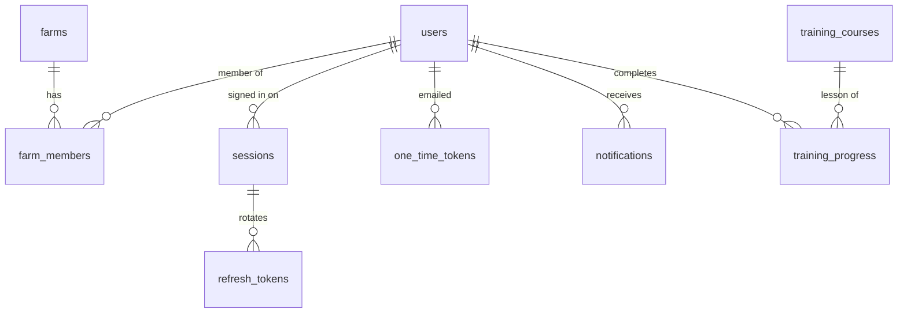
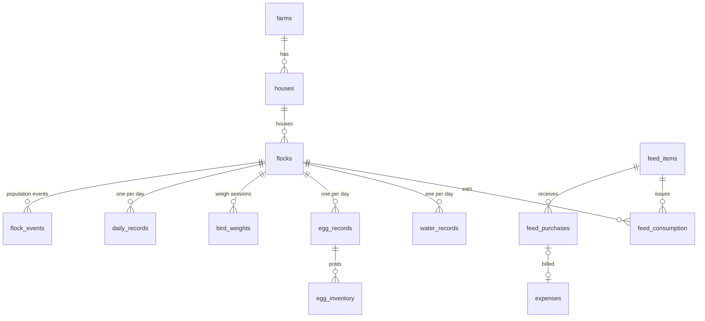
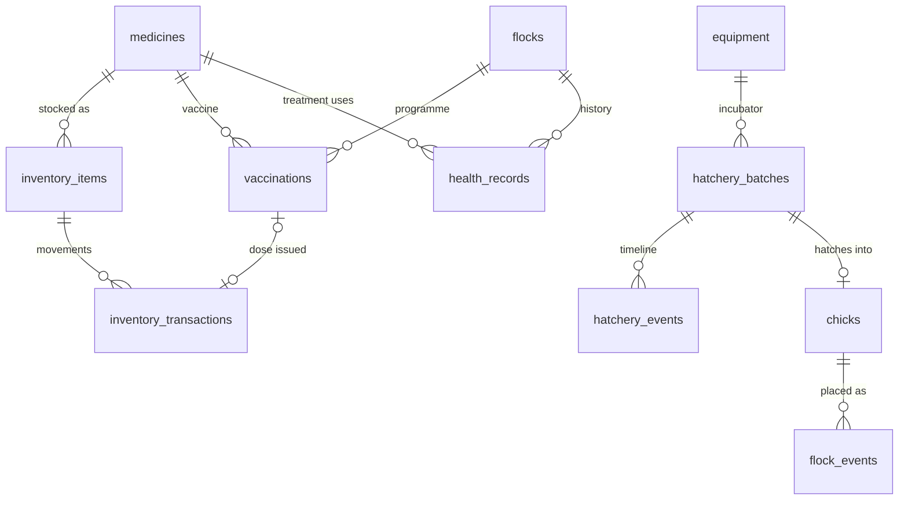
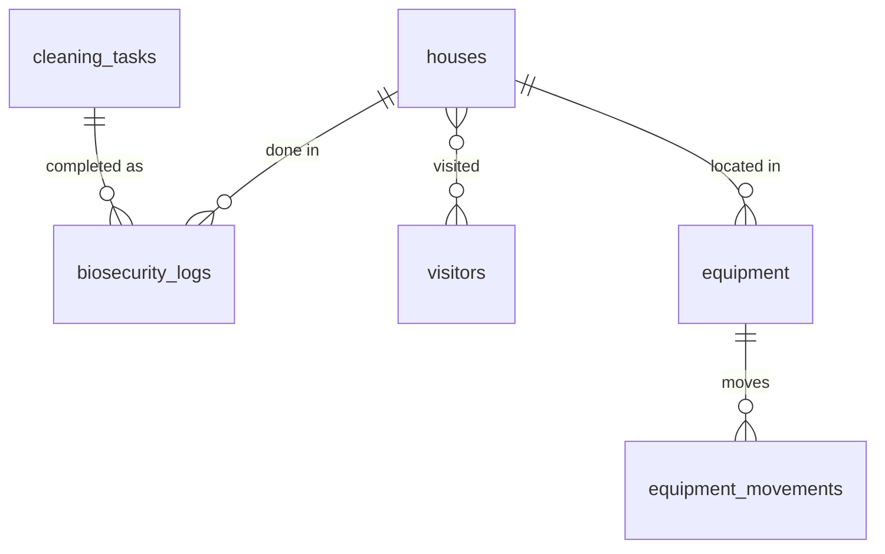
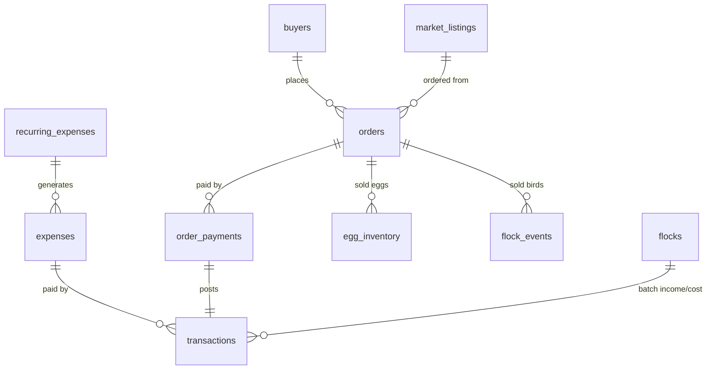
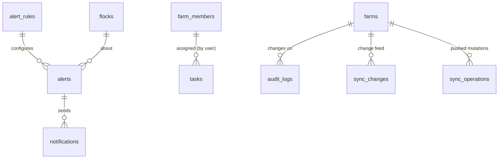

# PoultryPilot data model

How the MongoDB collections fit together and the rules every collection follows. The field-by-field reference is the generated [data dictionary](data-dictionary.md); schemas live in `services/api/src/adapters/mongo/models/`.

52 collections: the 46 the product needs, plus 6 for authentication and infrastructure (`sessions`, `refresh_tokens`, `one_time_tokens`, `sync_changes`, `idempotency_keys`, `counters`). 85 secondary indexes, each tied to a named query.

## Conventions

| Concern | Rule |
| --- | --- |
| IDs | `_id` is a UUIDv7 string, generated by the client or server. Offline-created records keep their id after sync. All references are these strings |
| Business dates | Farm-local `YYYY-MM-DD` strings (`date`, `dueDate`, `hatchDate`), interpreted in the farm's timezone |
| Instants | UTC `Date` (`createdAt`, `checkInAt`, `sentAt`) |
| Money | `{ amountMinor, currency }`: integer minor units plus ISO 4217 code. Never floats |
| Units | Canonical metric in the field name: `quantityKg`, `weightsG`, `litres`, `temperatureMinC`. Conversion to imperial happens for display only |
| Enums | Lowercase snake_case values from `packages/constants`; the same lists feed Mongoose, Zod and clients |
| Unknown fields | Rejected (`strict: "throw"`), so a typo in code fails loudly instead of storing junk |
| Standard fields | Added by `defineCollection` according to ownership (below): `farmId`, `createdBy`, `updatedBy`, `createdAt`, `updatedAt`, `version`, `deletedAt`, `deletedBy` |

## Ownership

| Ownership | Collections | Standard fields | Access rule |
| --- | --- | --- | --- |
| Farm | 37 collections, e.g. flocks, daily_records, orders, sync_operations | `farmId`, `createdBy` (required), `updatedBy`, `version`, soft delete unless append-only | Every query includes `farmId`; the `requireFarmScope` plugin throws if it is missing. Indexes start with `farmId` |
| Tenant | farms | `createdBy`, `version`, soft delete | Read by `_id` after a membership check |
| User | users, sessions, refresh/one-time tokens, notifications, training_progress | per collection | Queried by `userId` of the signed-in person |
| Global | training_courses, articles, glossary_terms, market_prices, weather_cache | `createdBy`/`updatedBy` optional (staff or import job) | Readable by any signed-in user; written by staff tools or jobs |
| System | audit_logs, idempotency_keys, counters | none (actor is a domain field, e.g. `actorUserId`) | Written by the API only |

`createdBy` is required on every farm record people create. It is absent only where no person writes the record (sessions, tokens, sync, audit, cache, notifications) — listed and enforced in `schema.test.ts`.

### Reads that deliberately span farms

These are the only queries allowed without `farmId`. They pass `setOptions({ crossFarm: true })` and are covered by their own indexes:

| Query | Index |
| --- | --- |
| Marketplace browse and "near me" (active listings only) | `market_listings` (status, category, createdAt), (location 2dsphere, status) |
| A marketplace buyer's purchases from all sellers | `orders` (buyerUserId, createdAt), partial |
| A person's memberships for `/me` and the farm switcher | `farm_members` (userId, status) |
| Accepting an invitation before membership exists | `farm_members` (inviteTokenHash) |

## Source of truth and derived data

Each fact has one home. Some values are also kept as **derived snapshots** for fast reads. These are written only by the owning service, in the same transaction as the change that affects them, and can always be rebuilt from their sources.

| Derived value | Maintained by | Rebuilt from |
| --- | --- | --- |
| `flocks.population` (placed, transferred in, mortality, culled, sold, moved out, adjustments, alive) | FlockService | `flock_events` (the flock ledger) |
| `bird_weights.stats` | the document itself on save (domain `weighSessionStats`) | `bird_weights.weightsG` |
| `feed_items.stock` (kg, value) | FeedService | `feed_purchases` − `feed_consumption`, moving average |
| `feed_consumption.cost` | FeedService at issue time | moving-average cost at that point in the ledger |
| `inventory_items.stock` | InventoryService | `inventory_transactions` |
| Egg stock per grade | aggregation, no snapshot | sum of `egg_inventory.quantityDelta` |
| `chicks.remaining` | HatcheryService / FlockService / OrderService | `chicks.quantity` − placements − chick sales |
| `hatchery_batches.results` | HatcheryService | `hatchery_events.counts` |
| `health_records.treatment.withdrawal*Until` | HealthService on save | `treatment.endDate` + `medicines.withdrawal*Days` |
| `expenses.amountPaid`, `expenses.status` | LedgerService | `transactions` with `sourceId` = expense |
| `orders.amountPaid`, `orders.paymentStatus` | OrderService | `order_payments` |
| Vaccination "overdue" | never stored | `status = scheduled` and `dueDate` < farm-local today |

## What writes what

When a record changes, the service writes these in **one transaction** (MongoDB replica set). It also writes an `audit_logs` entry and, for synced entities, a `sync_changes` entry.

| Action | Writes |
| --- | --- |
| Place chicks in a flock | `flock_events` (placement) → `flocks.population`; draws down `chicks.remaining` if from a lot; `expenses` for bought chicks (with the money module) |
| Save a daily record | `daily_records` + `flock_events` (mortality, cull; reversals of the record's previous ones) + `feed_consumption` + `water_records` → `flocks.population` |
| Transfer, split or merge birds | paired `flock_events` on both flocks (with cost and weight) → both snapshots; a split creates the new `flocks` document; a merge closes the source |
| Sell birds, adjust, weigh, close | `flock_events` → `flocks.population` (`bird_weights` for individual weights) |
| Save an egg record | `egg_records` + `egg_inventory` (collected, and broken as a negative movement); editing it reverses and re-posts by `sourceId` |
| Issue feed | `feed_consumption` (costed) → `feed_items.stock` |
| Receive feed | `feed_purchases` → `feed_items.stock`; `expenses` (unpaid or paid) |
| Pay an expense | `transactions` (expense) → `expenses.amountPaid/status` |
| Recurring bill falls due | `expenses` (unique per bill and due date), then `recurring_expenses.nextDueDate` |
| Give a vaccination | `vaccinations` (done) + `inventory_transactions` (issue) → `inventory_items.stock` |
| Record a treatment | `health_records` (withdrawal dates computed) + `inventory_transactions` + optional `expenses` |
| Deliver an order | `orders.status/statusHistory` + stock postings: `egg_inventory` (sold), `flock_events` (sale) or `chicks.remaining` |
| Receive a payment | `order_payments` + `transactions` (income) → `orders.amountPaid/paymentStatus` |
| Hatch results | `hatchery_events` → `hatchery_batches.results/status`; creates a `chicks` lot |
| Complete a cleaning task | `biosecurity_logs` (with cleaningTaskId) → `cleaning_tasks.lastDoneDate/nextDueDate` |
| Move equipment | `equipment_movements` → `equipment.houseId` |
| Alert job finds a problem | `alerts` (unique dedupKey) + `notifications` per recipient and channel |
| Offline mutation pushed | `sync_operations` (outcome, exactly once) + whatever the command writes |

> **Change with the flock engine (D35):** deaths and culls are `flock_events`, not fields on `daily_records`. A daily record posts them as events linked by `dailyRecordId`. The flock ledger is therefore the only place a bird-count change is stored. See [flock-engine.md](flock-engine.md).

## Corrections, deletion and retention

- **Editable records** (flocks, daily records, expenses…) are soft-deleted: `deletedAt` is set, the record stays for audit and sync, and queries filter with `deletedAt: null`.
  - That filter matches both missing and null. Never use `deletedAt: { $exists: false }`: new records store `deletedAt: null`. The repository contract test caught exactly this bug.
- **Unique constraints ignore soft-deleted records** ("live records only" in the dictionary), so a deleted house name can be reused.
- **Append-only ledgers** (`flock_events`, `egg_inventory`, `inventory_transactions`, `transactions`, `order_payments`, `hatchery_events`, `equipment_movements`, `sync_changes`) are never updated or deleted. A mistake is fixed by a new entry whose `reversalOf` points at the original, so balances and history always agree.
- **Retention by TTL index:**

  | Collection | Kept for |
  | --- | --- |
  | `sessions` | 30 days after expiry |
  | `refresh_tokens` | 7 days after expiry |
  | `one_time_tokens` | 1 day after expiry |
  | `idempotency_keys` | 7 days |
  | `sync_operations` | 90 days |
  | `notifications` | 180 days |
  | `weather_cache` | until expiry |

  Audit logs and farm data have no TTL.

## Embed or reference

| Embedded | Why |
| --- | --- |
| Sample weights in `bird_weights` | Read only with their session; capped at 2,000 |
| Lines and status history in `orders` | Read with the order; capped at 50 lines |
| Lessons in `training_courses` | Read with the course; a few per course |
| Treatment in `health_records`, results in `hatchery_batches` | One per parent document |
| Checklists in `cleaning_tasks`, `biosecurity_logs` | Small, owned by the parent |

Everything that grows without bound, or is queried on its own, has its own collection: feed consumption, egg movements, payments, flock events, hatchery events, transactions.

## Relationships

The full list of references is generated at the end of the [data dictionary](data-dictionary.md#relationship-index). Every farm-owned collection also belongs to `farms` through `farmId`. The diagrams below show each domain; `}o--||` reads "many to one".

### Identity and tenancy

### Production, feed and water

### Health, inventory and hatchery

### Biosecurity and equipment

### Money and market

### Operations and system

## From the prototype's Supabase tables

Used by the data import (roadmap Phase 8).

| Supabase table | New collections | Notes |
| --- | --- | --- |
| `profiles` | `users`, `farms`, `farm_members` | One farm and an owner membership per profile |
| `houses` | `houses` | |
| `flocks` | `flocks`, `flock_events` | `chicks_received`/`bird_count` → placement event; sale columns → sale event |
| `daily_logs` | `daily_records`, `flock_events` (mortality), `egg_records`, `egg_inventory`, `feed_consumption` | Partial rows merged per flock and date; deaths become mortality events; unassigned rows go to review |
| `bird_weights` | `bird_weights` | Individual weights grouped into sessions by flock and date |
| `feed_items` | `feed_items`, `feed_purchases` | Each purchase row becomes an item (by name) plus a purchase |
| `health_records` | `health_records`, `vaccinations` | `record_type = vaccination` rows become vaccinations; `next_due` becomes a scheduled vaccination |
| `hatchery_batches` | `hatchery_batches`, `hatchery_events`, `chicks` | Results become hatch events; hatched chicks become a lot |
| `biosecurity_logs` | `biosecurity_logs`, `visitors` | `visitor` rows move to visitors |
| `transactions` | `expenses`, `transactions` | Expenses become paid expenses with a posting; free-text categories are mapped, unknowns queued |
| `recurring_expenses` | `recurring_expenses` | `active = false` becomes a pause |
| `buyers`, `market_listings`, `orders`, `order_payments` | same names | Listing contact is dropped (shared via orders only); prices re-validated |
| `alerts` | `alerts` | Historical only |
| `training_progress` | `training_progress` | Lesson ids mapped to the imported courses |

## Verification

- `schema.test.ts`, run in every build, checks that:
  - every requested collection exists
  - standard fields are present
  - every reference resolves
  - enums come from the constants
  - farm indexes start with `farmId` (exceptions listed above)
  - no index is a redundant prefix of another
  - the tenancy guard is active on every farm-owned model
  - computed fields and validators behave as described
- `data-dictionary.test.ts` fails if the dictionary is out of date.
- `repositories.contract.test.ts` runs the repository contract against a live server.
- All 85 indexes were created against FerretDB, which speaks the MongoDB protocol, except 18 that use features FerretDB lacks: TTL, partial, 2dsphere and text indexes. CI creates them on MongoDB 7.
